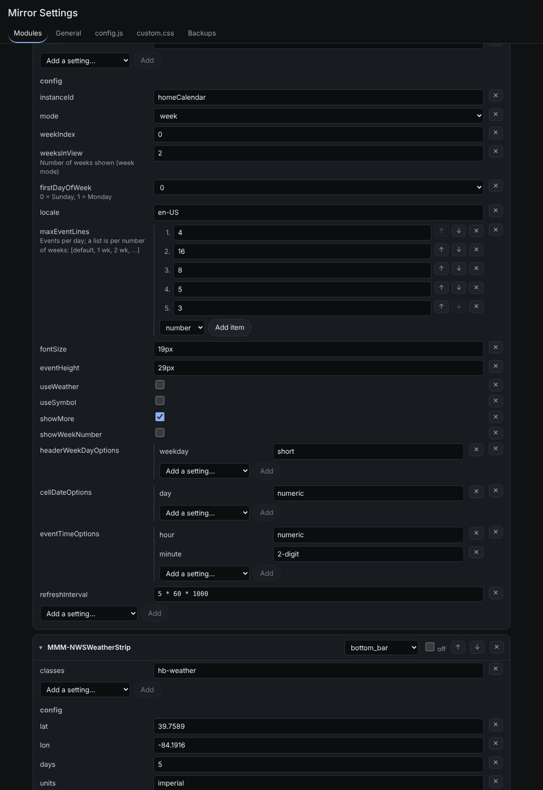

# MMM-ConfigEditor

A settings page for [MagicMirror²](https://github.com/MagicMirrorOrg/MagicMirror) that edits
`config.js` **in place**. It changes only the values you edit, so your comments, formatting,
functions and anything it doesn't understand stay exactly as they were.



## Why

Form-based config editors usually rebuild `config.js` from scratch on save. When they can't
represent something (a list of objects, a function, `5 * 60 * 1000`) the saved file can break,
or lose comments. MMM-ConfigEditor works differently:

- **Edits the source, not a copy of it.** The file is parsed only to find where each value sits;
  saving replaces just those characters.
- **Types come from your file.** A list of objects is edited as a list of objects because that's
  what's in your config. Values written as code are edited as code.
- **Discovers options.** "Add a setting…" lists each module's own default options, read from the
  module's file. No per-module schema needed.
- **Never saves a broken config.** Every save is parsed and loaded in a separate Node process
  first; if it doesn't load and export a `modules` list, nothing is written.
- **Backs up every save** (last 30 of each file) with one-click restore.
- **Edits `custom.css` too**, applied on the mirror immediately, no restart.

## Features

- **Modules:** every module with its position, an off switch, move up/down, remove, module-level
  settings (header, classes, …) and its `config`. Add any installed module.
- **General:** top-level settings (port, address, timeFormat, units, …).
- **config.js / custom.css:** edit the files directly, with a check button.
- **Backups:** restore any earlier version.

## Install

```bash
cd ~/MagicMirror/modules
git clone https://github.com/Justin-Shultz/MMM-ConfigEditor
cd MMM-ConfigEditor
npm install
```

Add it to `config/config.js` (it needs no position):

```js
{
	module: "MMM-ConfigEditor",
	config: {
		restart: "exit"
	}
},
```

Then open `http://<mirror-ip>:8080/MMM-ConfigEditor/`.

To reach it from another device, MagicMirror must listen on the network and allow that device:

```js
address: "0.0.0.0",
ipWhitelist: [], // [] allows any device on your network
```

## Update
Update this module by navigating to its directory and using git pull:

```bash
cd ~/MagicMirror/modules/MMM-ConfigEditor
git pull
npm install --omit=dev
```

## Options

| Option | Default | Description |
|---|---|---|
| `restart` | `"exit"` | What happens after a config.js save. `"exit"` quits MagicMirror so pm2, systemd or a kiosk loop starts it again with the new config. `"none"` only saves. Any other text is run as a shell command, e.g. `"pm2 restart MagicMirror"`. |

## For module authors: dropdowns and help text

Without anything extra, your module's settings appear with text, number and on/off fields based on
their values. To offer fixed choices or a short explanation, add `config-editor.json` to your module
folder:

```json
{
	"interval": { "enum": ["30s", "1m", "5m"], "help": "How long each photo stays up" },
	"units": { "enum": ["metric", "imperial"] }
}
```

Choices for a few common modules (clock, calendar, weather, MMM-CalendarExt3, MMM-MyScoreboard) are
built in.

## Security

Anyone who can open the page can change your config, and `restart` can run a shell command you set.
Keep MagicMirror on your home network and don't forward its port to the internet.

## Limitations

- Option discovery runs each module's file in the browser to read its `defaults`. Modules that
  can't be loaded that way still show their current settings, just without suggestions.
- Settings defined outside the main `config = { ... }` object (e.g. built from variables elsewhere
  in the file) show as code values.
- When an item is moved, a comment line written directly above it stays where it was.

## Development

```bash
npm install
npm test
```

## License

MIT

---

If you liked this project or it helped you, consider [buying me a coffee](https://ko-fi.com/justin23111) ☕
